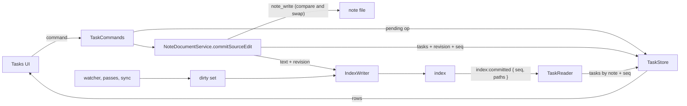

# Tasks data flow

How a task gets from a Markdown file to a row in the Tasks view and back. The
code is in `packages/core/src/tasks/`, `packages/core/src/documents/` and
`packages/core/src/indexing/`.

## Vocabulary

| Term | Meaning |
| --- | --- |
| revision | The lowercase hex SHA-256 of the full text of a note file. Rust computes it; every note read and write returns it. |
| index seq | The commit number of the index. Each committed write transaction adds one. A read returns the seq it saw. |
| address | Where a task is in the note text at one revision: `{ notePath, revision, astPath, markdown, checked }`. Only writes use it. |
| identity | The `taskId` that `TaskStore` gives a task. It is stable for one run of the app, and it is the React key and the key of selection, struck state and drafts. |
| pending op | A change that a write in flight is about to make. The rows show it until the write ends. |
| draft | Text typed into the editor of a task that no write has taken yet. |
| new task | A row with no file text. It is written when a command names it while it holds text. |
| dirty set | The paths whose file may differ from the index. |

## Invariants

1. The Markdown file is the truth. Every other state is a function of it and carries its revision.
2. Each state has one writer:
   - Note text: `NoteDocumentService` (`commitSourceEdit`, `commitFrontmatter`) and the editor session save. Only they receive `WritableNoteFileService`.
   - Index projections: `IndexWriter`. Only the index lifecycle receives `WritableIndexStoreService`.
   - Task rows: `TaskStore`.
3. When a note commit resolves, the index holds the committed text, and the store holds the tasks the commit left.
4. A read of an older index seq than the store knows for a note does not replace the rows of that note.
5. The dirty set collects file changes for the whole graph session, through passes, suspends and failures.
6. A write finds its task by address. When the text moved on, it takes the task at the same path with the same content, else the nearest task with the same content. It reports `stale` only when no such task exists.
7. The rows on screen are the stored rows with every pending op applied. Nothing else changes a row.

## Flow

A command names tasks by `taskId`. `TaskCommands` shows the change on the rows
at once, then queues one write per note. A write takes the address of its tasks
from the store when it starts, so a command never waits for another and is
never dropped. The writes of one note run in order; different notes are written
at the same time. A command that completes or reopens a task names the state it
wants, so a task that already has that state when the write starts stays as it
is.

`commitSourceEdit` applies a transform to the note. For an open note the
transform runs on the editor session buffer. For a closed note it runs on the
file text, and the write lands only while the file still holds that text; a
file that changed runs the transform again.

A commit writes its text to the index before it resolves, so the result of the
user's own write reaches the store directly. The index notifies `TaskReader`
for every other change (another app, sync, the first pass), and the reader
loads the tasks of the named notes.

## Failures

The app recovers by itself where it can. A read that fails keeps the rows and
tries again with backoff. A write that finds its task gone reads the note again,
in one try, and runs once more. A write that still fails, or whose read failed,
ends and keeps the typed text in its row while the row exists;
the next command that names the row, or the app going to the background, writes
it again. The user sees a message only when their own text cannot be saved as
one task, or the note is not writable.
